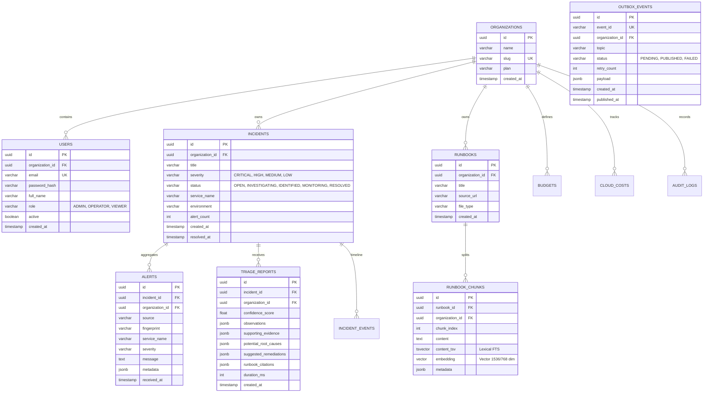

# OpsPilot - Database Design & Schema Specification

## 1. Overview

OpsPilot relies on **PostgreSQL 16** as its unified relational and vector datastore. It utilizes the **`pgvector`** extension for vector similarity search alongside native PostgreSQL **`tsvector`** for lexical full-text retrieval.

Multi-tenancy is enforced logically via non-nullable `tenant_id` columns with indexed foreign keys across all tenant-scoped tables.

---

## 2. Entity Relationship Overview

---

## 3. Core Table Definitions & Indexes

### 3.1 Multi-Tenancy & Identity
- **`organizations`**: Master tenant records.
  - Index: `UNIQUE (slug)`
- **`users`**: Tenant user membership with RBAC.
  - Index: `UNIQUE (organization_id, email)`
  - Check constraint: `role IN ('ADMIN', 'OPERATOR', 'VIEWER')`

### 3.2 Incident Management & Ingestion
- **`incidents`**:
  - Index: `INDEX idx_incidents_tenant_status (organization_id, status)`
  - Index: `INDEX idx_incidents_tenant_service (organization_id, service_name)`
  - Index: `INDEX idx_incidents_created_at (created_at DESC)`
- **`alerts`**:
  - Index: `INDEX idx_alerts_fingerprint (organization_id, fingerprint, received_at DESC)`: Rapid deduplication.
  - Index: `INDEX idx_alerts_incident (incident_id)`

### 3.3 Transactional Outbox
- **`outbox_events`**:
  - Index: `INDEX idx_outbox_pending (status, created_at)`: Polled by background worker.
  - Unique Constraint: `UNIQUE (event_id)`: Prevents duplicate insertions.

### 3.4 Hybrid RAG Storage (`runbook_chunks`)
- Lexical Search:
  - Column: `content_tsv tsvector GENERATED ALWAYS AS (to_tsvector('english', content)) STORED`
  - Index: `CREATE INDEX idx_runbook_tsv ON runbook_chunks USING GIN(content_tsv);`
- Vector Similarity:
  - Extension: `CREATE EXTENSION IF NOT EXISTS vector;`
  - Column: `embedding vector(1536)` (or 768 depending on model choice)
  - Index: `CREATE INDEX idx_runbook_embedding ON runbook_chunks USING hnsw (embedding vector_cosine_ops);`
- Tenant Isolation:
  - Composite Index: `INDEX idx_chunks_tenant (organization_id, runbook_id)`

### 3.5 FinOps Intelligence
- **`cloud_costs`**:
  - Normalized daily/hourly billing items.
  - Columns: `id`, `organization_id`, `service_name`, `environment`, `cost_amount`, `currency`, `usage_date`, `tags (jsonb)`.
  - Indexes: `INDEX idx_costs_tenant_date (organization_id, usage_date DESC)`, `INDEX idx_costs_service (organization_id, service_name, usage_date)`.
- **`cost_anomalies`**:
  - Detected statistical cost spikes.
  - Columns: `id`, `organization_id`, `service_name`, `expected_cost`, `actual_cost`, `z_score`, `detected_at`, `status`.
