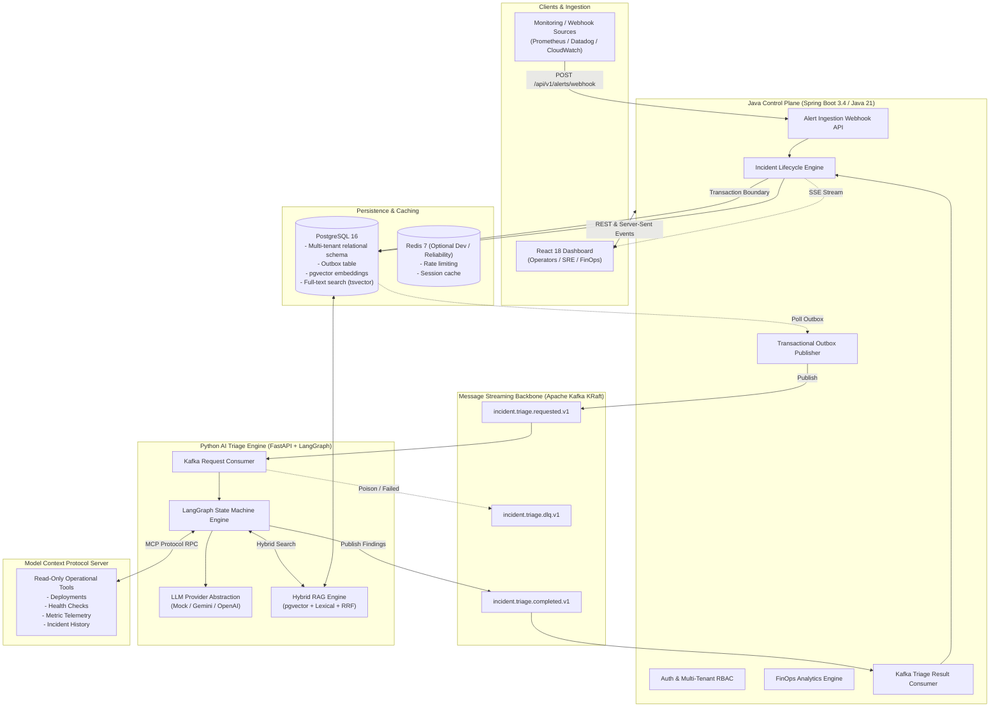

# OpsPilot - System Architecture

## 1. High-Level Distributed Architecture

OpsPilot is architected as an event-driven distributed system comprising four decoupled tiers:
1. **Frontend Presentation Tier**: React 18 + TypeScript + Vite SPA.
2. **Java Control Plane Tier**: Java 21 + Spring Boot 3 + Spring Data JPA + Spring Security.
3. **Event Streaming Backbone**: Apache Kafka (KRaft mode) with transactional outbox and Dead-Letter Queues (DLQ).
4. **AI Reasoning & Tooling Tier**: Python 3.11+ (FastAPI + LangGraph) with Model Context Protocol (MCP) server & Hybrid RAG (PostgreSQL pgvector + full-text search).

---

## 2. Distributed Communication & Data Flows

### Flow A: Alert Ingestion to Outbox Transaction
1. External monitoring system sends an alert JSON payload to `/api/v1/alerts/webhook`.
2. The Alert Controller validates the payload against `IncidentAlertV1` schema, extracts tenant context from the API key / token, and checks for deduplication via SHA-256 fingerprint within a sliding time window.
3. If new, an `Incident` entity is created or updated in status `OPEN`.
4. In the **same database transaction**, an `OutboxEvent` record is persisted containing the `IncidentTriageRequestedV1` payload.
5. The HTTP response immediately returns `202 Accepted` with the `incidentId` and `correlationId`.

### Flow B: Transactional Outbox to Kafka KRaft
1. A scheduled Spring outbox poller selects unpublished outbox events with pessimistic row-locking (`SELECT FOR UPDATE SKIP LOCKED`).
2. The publisher sends the message to the Kafka topic `incident.triage.requested.v1` using Kafka Producer with `acks=all`.
3. Upon producer acknowledgment, the outbox record is marked `PUBLISHED` (or deleted based on retention policy).
4. **Guarantees**: At-least-once delivery without distributed two-phase commits.

### Flow C: Python LangGraph AI Investigation
1. The Python AI consumer receives the event, checks local Redis/Postgres idempotency keys (`triage_processed:{incidentId}:{version}`), and initializes the LangGraph state machine.
2. The state machine executes the sequential and fan-out nodes:
   - **Validate & Normalise Context**: Sanitize inputs, determine scope.
   - **Severity & Category Classification**: Classify operational impact.
   - **Parallel Retrieval**:
     - Query pgvector + full-text search in PostgreSQL for relevant runbook chunks. Apply Reciprocal Rank Fusion (RRF).
     - Call MCP Server tools (`get_recent_deployments`, `get_service_health`, `query_service_metrics`).
   - **Hypothesis Formulation & Evidence Validation**: Cross-reference retrieved metrics and commit hashes with observed symptoms. Only hypotheses with verified backing evidence are accepted.
   - **Remediation & Action Plan**: Propose non-destructive operator steps with explicit `requiresApproval: true`.
3. Formulate the `IncidentTriageCompletedV1` envelope and publish to `incident.triage.completed.v1`.

### Flow D: Control Plane Ingestion & Dashboard Live Update
1. Spring Boot Kafka consumer reads `incident.triage.completed.v1`.
2. Persists the investigation findings, citations, and suggested actions to PostgreSQL.
3. Updates the incident state to `INVESTIGATING` or `IDENTIFIED`.
4. Emits a Server-Sent Event (SSE) to connected frontend clients subscribed to `/api/v1/incidents/{incidentId}/events` or the global incident stream.

---

## 3. Reliability & Fault Tolerance Strategy

| Failure Scenario | Mitigation Strategy |
| :--- | :--- |
| **Kafka broker temporarily unavailable** | Spring Boot writes to the outbox table in Postgres; outbox poller backs off exponentially and resumes when Kafka recovers. No data lost. |
| **Python AI Engine crashes mid-investigation** | Consumer offset is not committed until processing completes. Kafka delivers the message to another consumer instance. Idempotency guards against duplicate processing. |
| **Poison message / malformed event** | Caught by error handler with maximum retry count (e.g. 3 retries with backoff). Routed to `incident.triage.dlq.v1` with diagnostic stack trace for engineer inspection. |
| **MCP Server timeout or downstream service down** | LangGraph handles tool timeouts gracefully with fallback states, annotating the investigation findings with `uncertainties` rather than failing the whole pipeline. |
| **LLM provider rate-limit or downtime** | Abstracted LLM provider with exponential backoff and deterministic fallback mock engine; ensures business continuity in automated environments. |

---

## 4. Multi-Tenant Isolation Architecture

OpsPilot implements **Logical Multi-Tenancy via Shared Database, Partitioned Data (Row-Level Security / Discriminator Column)**:
- Every tenant has a unique `organization_id` (UUID).
- Every core entity (`incidents`, `alerts`, `runbooks`, `budgets`, `audit_logs`) has a non-nullable `tenant_id` foreign key.
- Spring Data JPA repositories enforce tenant filtering via Spring Security's authenticated `TenantContextHolder`.
- Direct cross-tenant queries are blocked at both the service layer and repository query specifications.
- Automated integration tests explicitly verify that Tenant A cannot read, mutate, or query Tenant B's data under any condition.
